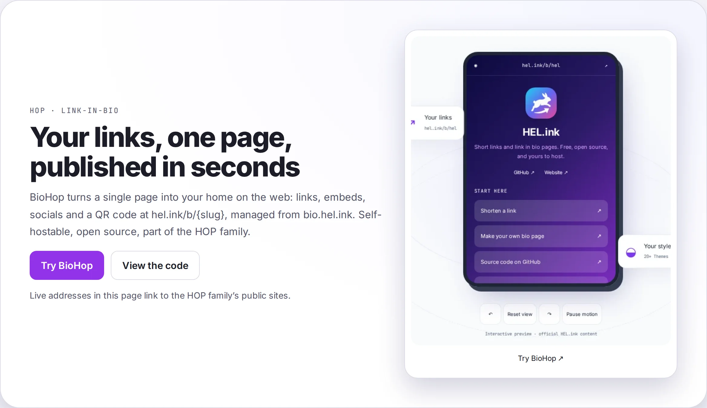

<p align="center">🌐 <a href="README.md">English</a> · <a href="README.zh-CN.md">简体中文</a> · <a href="README.de.md">Deutsch</a> · <a href="README.id.md">Bahasa Indonesia</a> · <a href="README.ja.md">日本語</a> · <a href="README.pt-BR.md">Português (Brasil)</a> · <b>Español</b> · <a href="README.fr.md">Français</a> · <a href="README.ru.md">Русский</a></p>

# BioHop

<p align="center">
  <a href="LICENSE"></a>
  <a href="https://github.com/navi-crwn/BioHop/actions/workflows/tests.yml"></a>
</p>

<p align="center"><picture><source media="(prefers-color-scheme: dark)" srcset="docs/readme/hero-en-dark.webp"></picture></p>

<p align="center"><b>Una página con tus enlaces, contenido incrustado, redes sociales y un código QR — publicada en <code>hel.ink/b/{slug}</code>.</b></p>

<p align="center">
  <a href="https://bio.hel.ink">bio.hel.ink</a> ·
  <a href="#ejecutarlo-tú-mismo">Ejecútalo tú mismo</a> ·
  <a href="#funciones">Funciones</a> ·
  <a href="#preguntas-frecuentes">Preguntas frecuentes</a> ·
  <a href="#seguridad">Seguridad</a> ·
  <a href="#licencia">Licencia</a>
</p>

---

Instala con un solo comando (primero revisa tu equipo, hace unas pocas preguntas y puede instalar el hub HOP ID por ti):

```bash
curl -fsSL https://raw.githubusercontent.com/navi-crwn/BioHop/main/install.sh | bash
```

Desde un clon: `./install.sh` · actualizar: `./update.sh` · quitar: `./uninstall.sh`. Con `--yes` se usan todos los valores por defecto; `--help` lista las opciones.

## ¿Qué es BioHop?

BioHop es una aplicación de link-in-bio: montas una sola página con tus enlaces, imágenes, contenido incrustado y redes sociales, eliges un tema y la publicas en `hel.ink/b/{slug}` — con un código QR listo para compartir.

Es la mitad de bio de lo que antes era una sola aplicación (ahora [LinkHop](https://github.com/navi-crwn/LinkHop), el acortador de URL). Las cuentas viven en el hub ([HEL.ink](https://github.com/navi-crwn/HEL.ink)): aquí no hay registro ni contraseñas — inicias sesión una vez con tu **HOP ID** y la aplicación ya te reconoce. El plan detrás de la división está documentado en [`docs/planning/PLAN-pemisahan-aplikasi.md`](docs/planning/PLAN-pemisahan-aplikasi.md) (la fase D es este repositorio).

<a id="funciones"></a>

## Funciones

- **Páginas de bio públicas en `hel.ink/b/{slug}`, cada una con código QR y seguimiento de clics.**
- **Un editor en `/bio` para páginas, enlaces, subida de imágenes/avatar/iconos/logotipo del QR, vista previa en vivo, duplicación y analíticas por página.**
- **Temas predefinidos (light, dark, minimal, neon y muchos más) compartidos por el editor, su vista previa y la página pública.**
- **Sin registro local ni contraseñas: inicias sesión una vez con tu HOP ID en el hub.**
- **Analíticas de clics con país (GeoIP) además de detección de dispositivo, navegador y bots.**
- **"Shorten this URL" en los bloques mediante la API de LinkHop con el token de servicio del propio miembro; si LinkHop no responde, el bloque conserva su URL original.**
- **Seguridad de URL/contenido: `abuse:scan` con la `domain_blacklist` compartida (hop/safety), programado cada hora.**
- **Poda diaria de los datos de clics (`privacy:prune`).**

<a id="ejecutarlo-tú-mismo"></a>

## Ejecútalo tú mismo

Necesitas PHP 8.3, Composer y Node 20+. Los paquetes compartidos `hop/auth`, `hop/ui` y `hop/safety` vienen de sus repositorios de GitHub (`navi-crwn/hop-auth`, `hop-ui`, `hop-safety`, rama `main`, listados como repositorios `vcs` en `composer.json`).

```bash
git clone git@github.com:navi-crwn/BioHop.git
cd BioHop
composer install
cp .env.example .env && php artisan key:generate
```

**Configura antes de migrar.** Abre `.env` (`.env.example` documenta todas las claves; sus comentarios son la referencia) y define al menos:

| Clave | Qué es |
|---|---|
| `APP_URL` / `PUBLIC_URL` | La dirección de esta aplicación y la dirección pública donde se sirven las páginas |
| `HOP_HUB_URL` | La dirección de tu hub (el inicio de sesión con HOP ID va allí) |
| `HOP_APP` | El identificador de esta aplicación en el hub: `biohop` |
| `HOP_SSO_SECRET` o `HOP_SSO_SECRET_BIOHOP` | El secreto SSO compartido con el hub, 32 caracteres o más |
| `LINKHOP_URL` | La dirección de tu LinkHop (activa "shorten this URL" en los bloques) |
| `DB_CONNECTION`, `DB_*`, `DB_MIGRATIONS_TABLE` | Ajustes de base de datos; `DB_MIGRATIONS_TABLE=migrations_bio` mantiene separado el registro de migraciones de esta aplicación |

```bash
php artisan migrate      # registra solo en migrations_bio
php artisan storage:link
npm install && npm run build
php artisan serve        # http://localhost:8000
```

**Base de datos.** BioHop está diseñado para compartir una única base de datos MySQL con el hub y LinkHop (cada aplicación lleva su propio registro de migraciones: `migrations_bio` aquí). Ejecuta primero las migraciones del hub, para que existan tablas como `users`, `roles`, `api_tokens` y `domain_blacklist`. Este es el diseño documentado; la compatibilidad de migraciones entre las versiones de las aplicaciones no está verificada en este README, así que compruébalo antes de apuntar BioHop a una base de datos que te importe.

**Las pruebas** se ejecutan sobre sqlite en memoria; las tablas que pertenecen a otras aplicaciones las crea `database/migrations/testing/` (solo para pruebas).

```bash
php artisan test
vendor/bin/pint --test
```

## Inicio de sesión (HOP ID)

Inicia sesión con tu HOP ID en el hub — aquí no hay registro ni contraseñas. El inicio de sesión y el editor usan SSO estándar, que requiere que los ajustes `HOP_HUB_URL`, `HOP_APP=biohop` y el secreto SSO de arriba estén listos antes de iniciar sesión. Abrir `/bio` te lleva al hub y de vuelta. Cerrar sesión termina tu sesión aquí y redirige al cierre de sesión del HOP ID.

Las páginas de bio públicas (`/b/{slug}`) no requieren inicio de sesión. BioHop está diseñado para funcionar junto con el hub — no es una aplicación independiente.

<a id="preguntas-frecuentes"></a>

## Preguntas frecuentes

**¿Qué pasa con mis datos de clics?** El seguimiento de clics existe para mostrarte el rendimiento de tu página, y el comando `privacy:prune` elimina los datos de clics a diario. No se conserva a propósito ningún archivo histórico de clics a largo plazo.

**¿El análisis de seguridad se ejecuta solo?** Sí. `abuse:scan` está programado cada hora y revisa las páginas y bloques de bio contra la `domain_blacklist` compartida de hop/safety. Son mecanismos, no garantías: ningún análisis automatizado promete detectarlo todo.

**¿Puedo usar BioHop sin el hub?** No. Editar requiere un HOP ID en el hub, y no hay registro local ni contraseñas. Las páginas de bio públicas no requieren inicio de sesión, pero la aplicación está diseñada para funcionar junto con el hub, y BioHop no puede garantizar que las rutas públicas nunca contacten al hub.

**¿Puedo autoalojarlo?** Sí — con licencia MIT, y la sección de arriba es toda la guía de inicio rápido. Tú aportas tu propio hub, LinkHop y base de datos.

<a id="familia"></a>

## La familia HOP

BioHop forma parte de la familia **HOP** de aplicaciones de código abierto autoalojables detrás de [hel.ink](https://hel.ink).

| Aplicación | Qué hace | Dirección | Código |
|---|---|---|---|
| **Hub** | Portal de cuentas, inicio de sesión con HOP ID | `hel.ink` · `hub.hel.ink` | [navi-crwn/HEL.ink](https://github.com/navi-crwn/HEL.ink) |
| **LinkHop** | Acortador de URL | `link.hel.ink` · `hel.ink/l/{slug}` | [navi-crwn/LinkHop](https://github.com/navi-crwn/LinkHop) |
| **BioHop** | Páginas link-in-bio | `bio.hel.ink` · `hel.ink/b/{slug}` | este repositorio |
| **PixelHop** | Alojamiento de imágenes y multimedia | `pixel.hel.ink` · `p.hel.ink` | [navi-crwn/PixelHop](https://github.com/navi-crwn/PixelHop) |
| **NoteHop** | Notas y documentos privados | `note.hel.ink` · `n.hel.ink` | [navi-crwn/NoteHop](https://github.com/navi-crwn/NoteHop) |

<a id="seguridad"></a>

## Seguridad

¿Encontraste una vulnerabilidad? Repórtala de forma privada a través de los security advisories de GitHub de este repositorio: [github.com/navi-crwn/BioHop/security/advisories](https://github.com/navi-crwn/BioHop/security/advisories). No abras issues públicas para informes de seguridad, ni publiques secretos, tokens o detalles de explotación en lugares públicos. Consulta [SECURITY.md](SECURITY.md) para más detalles.

<a id="licencia"></a>

## Licencia

[MIT](LICENSE) — como el resto de la familia HOP. Las licencias de terceros están listadas en el archivo [LICENSE](LICENSE).

---

<p align="center"><sub>BioHop · parte de la familia HOP · <a href="https://hel.ink">hel.ink</a></sub></p>
