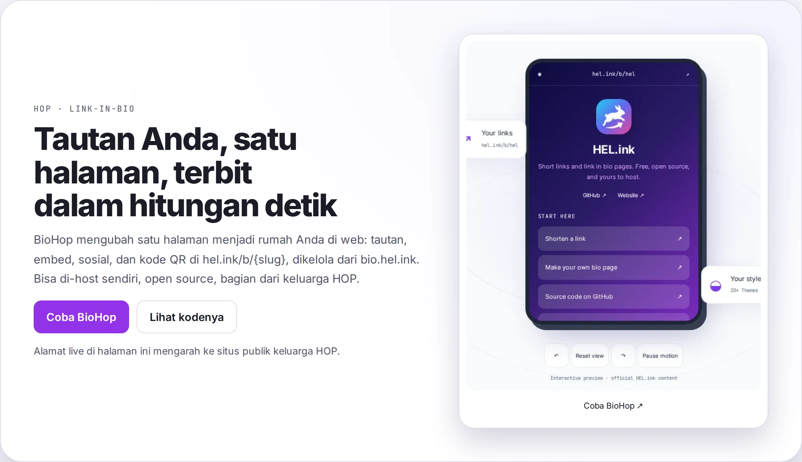

<p align="center">🌐 <a href="README.md">English</a> · <a href="README.zh-CN.md">简体中文</a> · <a href="README.de.md">Deutsch</a> · <b>Bahasa Indonesia</b> · <a href="README.ja.md">日本語</a> · <a href="README.pt-BR.md">Português (Brasil)</a> · <a href="README.es.md">Español</a> · <a href="README.fr.md">Français</a> · <a href="README.ru.md">Русский</a></p>

# BioHop

<p align="center">
  <a href="LICENSE"></a>
  <a href="https://github.com/navi-crwn/BioHop/actions/workflows/tests.yml"></a>
</p>

<p align="center"><picture><source media="(prefers-color-scheme: dark)" srcset="docs/readme/hero-id-dark.webp"></picture></p>

<p align="center"><b>Satu halaman berisi tautan, embed, media sosial, dan kode QR Anda — terbit di <code>hel.ink/b/{slug}</code>.</b></p>

<p align="center">
  <a href="https://bio.hel.ink">bio.hel.ink</a> ·
  <a href="#jalankan-sendiri">Jalankan sendiri</a> ·
  <a href="#fitur">Fitur</a> ·
  <a href="#faq">FAQ</a> ·
  <a href="#keamanan">Keamanan</a> ·
  <a href="#lisensi">Lisensi</a>
</p>

---

Pasang dengan satu perintah (memeriksa komputer Anda dulu, hanya bertanya beberapa hal, dan bisa memasang hub HOP ID sekalian):

```bash
curl -fsSL https://raw.githubusercontent.com/navi-crwn/BioHop/main/install.sh | bash
```

Dari hasil clone: `./install.sh` · perbarui: `./update.sh` · hapus: `./uninstall.sh`. Tambahkan `--yes` untuk memakai semua nilai bawaan; `--help` menampilkan opsinya.

## Apa itu BioHop?

BioHop adalah aplikasi link-in-bio: Anda menyusun satu halaman berisi tautan, gambar, embed, dan media sosial, memilih tema, lalu menerbitkannya di `hel.ink/b/{slug}` — lengkap dengan kode QR yang siap dibagikan.

BioHop adalah bagian bio dari dulu satu aplikasi (kini [LinkHop](https://github.com/navi-crwn/LinkHop), si pemendek URL). Akun tinggal di hub ([HEL.ink](https://github.com/navi-crwn/HEL.ink)): tidak ada registrasi atau kata sandi di sini — Anda masuk sekali dengan **HOP ID** dan aplikasi ini sudah mengenali Anda. Rencana pemisahan tersebut didokumentasikan di [`docs/planning/PLAN-pemisahan-aplikasi.md`](docs/planning/PLAN-pemisahan-aplikasi.md) (Fase D adalah repo ini).

<a id="fitur"></a>

## Fitur

- **Halaman bio publik di `hel.ink/b/{slug}`, masing-masing dengan kode QR dan pelacakan klik.**
- **Editor di `/bio` untuk halaman, tautan, unggahan gambar/avatar/ikon/logo QR, pratinjau langsung, duplikasi, dan analitik per halaman.**
- **Preset tema (light, dark, minimal, neon, dan banyak lagi) yang dipakai bersama oleh editor, pratinjaunya, dan halaman publik.**
- **Tanpa pendaftaran atau kata sandi lokal: Anda masuk sekali dengan HOP ID di hub.**
- **Analitik klik dengan negara (GeoIP) plus deteksi perangkat, peramban, dan bot.**
- **"Shorten this URL" di blok melalui API LinkHop dengan token layanan milik anggota sendiri; jika LinkHop mati, blok tetap memakai URL aslinya.**
- **Keamanan URL/konten: `abuse:scan` dengan `domain_blacklist` bersama (hop/safety), terjadwal setiap jam.**
- **Pembersihan data klik harian (`privacy:prune`).**

<a id="jalankan-sendiri"></a>

## Jalankan sendiri

Anda butuh PHP 8.3, Composer, dan Node 20+. Paket bersama `hop/auth`, `hop/ui`, dan `hop/safety` diambil dari repo GitHub masing-masing (`navi-crwn/hop-auth`, `hop-ui`, `hop-safety`, branch `main`, terdaftar sebagai repo `vcs` di `composer.json`).

```bash
git clone git@github.com:navi-crwn/BioHop.git
cd BioHop
composer install
cp .env.example .env && php artisan key:generate
```

**Konfigurasi sebelum migrasi.** Buka `.env` (`.env.example` mendokumentasikan semua kunci; komentarnya adalah referensinya) dan setel minimal:

| Kunci | Fungsinya |
|---|---|
| `APP_URL` / `PUBLIC_URL` | Alamat aplikasi ini dan alamat publik tempat halaman dilayani |
| `HOP_HUB_URL` | Alamat hub Anda (login HOP ID mengarah ke sana) |
| `HOP_APP` | Slug aplikasi ini di hub: `biohop` |
| `HOP_SSO_SECRET` atau `HOP_SSO_SECRET_BIOHOP` | Rahasia SSO yang dibagi dengan hub, 32+ karakter |
| `LINKHOP_URL` | Alamat LinkHop Anda (mengaktifkan "shorten this URL" di blok) |
| `DB_CONNECTION`, `DB_*`, `DB_MIGRATIONS_TABLE` | Pengaturan basis data; `DB_MIGRATIONS_TABLE=migrations_bio` memisahkan log migrasi aplikasi ini |

```bash
php artisan migrate      # hanya mencatat di migrations_bio
php artisan storage:link
npm install && npm run build
php artisan serve        # http://localhost:8000
```

**Basis data.** BioHop dirancang untuk berbagi satu basis data MySQL dengan hub dan LinkHop (tiap aplikasi punya log migrasi sendiri: `migrations_bio` di sini). Jalankan migrasi hub lebih dulu, agar tabel seperti `users`, `roles`, `api_tokens`, dan `domain_blacklist` sudah ada. Ini desain yang terdokumentasi; kompatibilitas migrasi antar rilis aplikasi tidak diverifikasi di README ini, jadi periksa dulu sebelum mengarahkan BioHop ke basis data yang Anda sayangi.

**Tes** berjalan di sqlite in-memory; tabel milik aplikasi lain dibuat oleh `database/migrations/testing/` (khusus tes).

```bash
php artisan test
vendor/bin/pint --test
```

## Login (HOP ID)

Masuk dengan HOP ID Anda di hub — tidak ada registrasi atau kata sandi di sini. Login dan editor memakai SSO standar, yang menuntut pengaturan `HOP_HUB_URL`, `HOP_APP=biohop`, dan rahasia SSO di atas sudah terpasang sebelum Anda login. Membuka `/bio` mengantar Anda ke hub dan kembali lagi. Logout mengakhiri sesi di sini lalu mengarahkan ke logout HOP ID.

Halaman bio publik (`/b/{slug}`) tidak butuh login. BioHop dirancang untuk berjalan bersama hub — bukan aplikasi mandiri.

<a id="faq"></a>

## FAQ

**Apa yang terjadi pada data klik saya?** Pelacakan klik ada untuk menunjukkan performa halaman Anda, dan perintah `privacy:prune` menghapus data klik setiap hari. Tidak ada arsip klik jangka panjang yang disimpan memang sengaja.

**Apakah pemindaian keamanan berjalan sendiri?** Ya. `abuse:scan` dijadwalkan setiap jam dan memeriksa halaman serta blok bio terhadap `domain_blacklist` bersama dari hop/safety. Ini mekanisme, bukan jaminan: tidak ada pemindaian otomatis yang menjanjikan menangkap segalanya.

**Bisakah saya memakai BioHop tanpa hub?** Tidak. Mengedit butuh HOP ID di hub, dan tidak ada registrasi atau kata sandi lokal. Halaman bio publik tidak butuh login, tetapi aplikasi ini dirancang berjalan bersama hub, dan BioHop tidak bisa menjamin rute publik tidak pernah menghubungi hub.

**Bisakah saya self-host?** Bisa — berlisensi MIT, dan bagian di atas adalah seluruh quickstart-nya. Anda menyediakan hub, LinkHop, dan basis data sendiri.

<a id="keluarga"></a>

## Keluarga HOP

BioHop adalah bagian dari keluarga **HOP**, aplikasi open-source yang bisa di-host sendiri di balik [hel.ink](https://hel.ink).

| Aplikasi | Fungsinya | Alamat | Kode |
|---|---|---|---|
| **Hub** | Portal akun, login HOP ID | `hel.ink` · `hub.hel.ink` | [navi-crwn/HEL.ink](https://github.com/navi-crwn/HEL.ink) |
| **LinkHop** | Pemendek URL | `link.hel.ink` · `hel.ink/l/{slug}` | [navi-crwn/LinkHop](https://github.com/navi-crwn/LinkHop) |
| **BioHop** | Halaman link-in-bio | `bio.hel.ink` · `hel.ink/b/{slug}` | repo ini |
| **PixelHop** | Hosting gambar & media | `pixel.hel.ink` · `p.hel.ink` | [navi-crwn/PixelHop](https://github.com/navi-crwn/PixelHop) |
| **NoteHop** | Catatan dan dokumen pribadi | `note.hel.ink` · `n.hel.ink` | [navi-crwn/NoteHop](https://github.com/navi-crwn/NoteHop) |

<a id="keamanan"></a>

## Keamanan

Menemukan kerentanan? Laporkan secara privat lewat security advisories GitHub untuk repo ini: [github.com/navi-crwn/BioHop/security/advisories](https://github.com/navi-crwn/BioHop/security/advisories). Mohon jangan membuka issue publik untuk laporan keamanan, dan jangan menyebar rahasia, token, atau detail eksploitasi di tempat publik. Lihat [SECURITY.md](SECURITY.md) untuk detailnya.

<a id="lisensi"></a>

## Lisensi

[MIT](LICENSE) — seperti seluruh keluarga HOP. Lisensi pihak ketiga tercantum di berkas [LICENSE](LICENSE).

---

<p align="center"><sub>BioHop · bagian dari keluarga HOP · <a href="https://hel.ink">hel.ink</a></sub></p>
