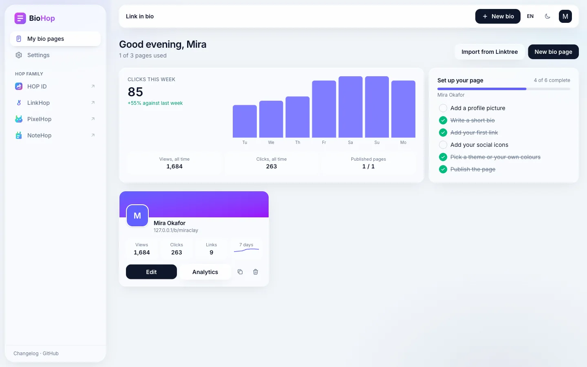
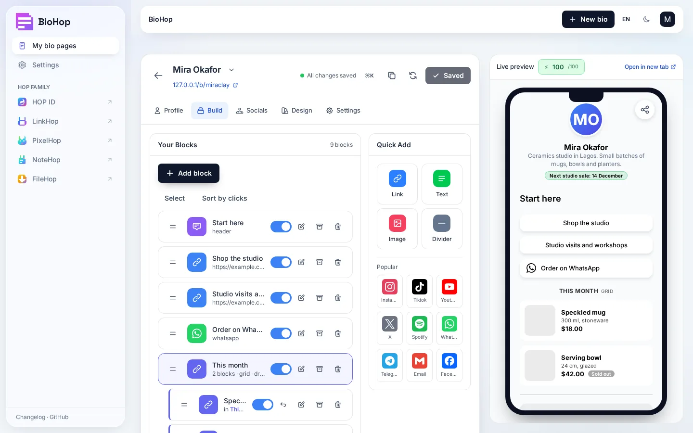
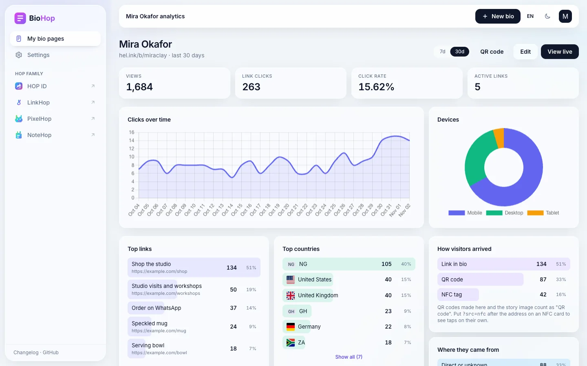
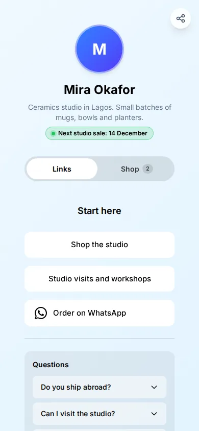
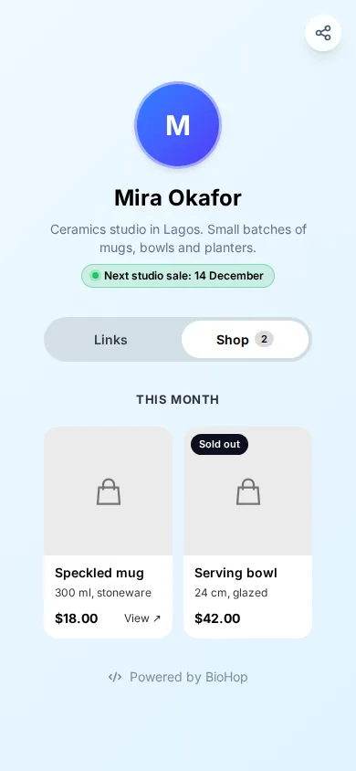

<p align="center">🌐 <a href="README.md">English</a> · <a href="README.zh-CN.md">简体中文</a> · <a href="README.de.md">Deutsch</a> · <a href="README.id.md">Bahasa Indonesia</a> · <b>日本語</b> · <a href="README.pt-BR.md">Português (Brasil)</a> · <a href="README.es.md">Español</a> · <a href="README.fr.md">Français</a> · <a href="README.ru.md">Русский</a></p>

# BioHop

<p align="center">
  <a href="LICENSE"></a>
  <a href="https://github.com/navi-crwn/BioHop/actions/workflows/tests.yml"></a>
</p>

<p align="center"><picture><source media="(prefers-color-scheme: dark)" srcset="docs/readme/dashboard-dark.webp"></picture></p>

<p align="center">リンク、埋め込み、SNS、QR コードを 1 ページにまとめます。ホスト版では <code>hel.ink/b/{slug}</code> で公開されます。</p>

<p align="center">
  <a href="https://bio.hel.ink">bio.hel.ink</a> ·
  <a href="#install">インストール</a> ·
  <a href="#features">機能</a> ·
  <a href="#run-your-own">自分で動かす</a> ·
  <a href="#privacy">プライバシー</a> ·
  <a href="#faq">よくある質問</a> ·
  <a href="#security">セキュリティ</a> ·
  <a href="#license">ライセンス</a>
</p>

---

<a id="install"></a>

## インストール

コマンドは 1 つです。まずお使いのコンピューターを確認し、いくつか質問し、HOP ID ハブのセットアップも代行できます。

```bash
curl -fsSL https://raw.githubusercontent.com/navi-crwn/BioHop/main/install.sh | bash
```

クローンからは `./install.sh`。更新は `./update.sh`、削除は `./uninstall.sh` です。`--yes` を付けるとすべて既定値になり、`--help` でオプションの一覧が出ます。インストーラーには PHP 8.3 以降、Composer、Node 20 以降、約 1 GB の空きディスク容量が必要です。`--dry-run` は手順を実行せずに表示します。

> [!NOTE]
> BioHop はアカウントを HOP ID ハブ（[HEL.ink](https://github.com/navi-crwn/HEL.ink)）に保存します。ハブなしのモードはありません。インストーラーは BioHop の隣にハブを設置する（既定、約 1 分）か、すでに運用中のハブに接続します。ハブと複数のアプリを一度にインストールするには、HEL.ink リポジトリの `install-family.sh` を使ってください。

## BioHop とは

BioHop は link-in-bio アプリです。リンク、画像、埋め込み、SNS アイコンで 1 ページを作り、テーマを選んで公開します。ホスト版の [bio.hel.ink](https://bio.hel.ink) がダッシュボードで、公開ページは `hel.ink/b/{slug}` にあります。自分のサーバーでは、ページは `{PUBLIC_URL}/b/{slug}` で配信されます。

BioHop には登録もパスワードもありません。ハブで HOP ID を使って一度サインインすれば、アプリがあなたを認識します。BioHop は、もとは 1 つのアプリだったものの bio 側として始まりました。もう一方は現在 URL 短縮サービスの [LinkHop](https://github.com/navi-crwn/LinkHop) です。分割の計画は [`docs/planning/PLAN-pemisahan-aplikasi.md`](docs/planning/PLAN-pemisahan-aplikasi.md) にあります（フェーズ D がこのリポジトリです）。

以下のスクリーンショットは、架空のサンプルデータ（陶芸スタジオのページ）を入れたローカルインストールで撮ったものです。実在の人物やアカウントは写っていません。

<p align="center"><picture><source media="(prefers-color-scheme: dark)" srcset="docs/readme/editor-dark.webp"></picture></p>

<p align="center"><picture><source media="(prefers-color-scheme: dark)" srcset="docs/readme/analytics-dark.webp"></picture></p>

<p align="center">
  
  &nbsp;
  
</p>

<a id="features"></a>

## 機能

### ページとエディター

- `/b/{slug}` の公開ページ。QR コード（`/b/{slug}/qr` で PNG をダウンロード）とインストール可能な Web アプリマニフェスト付きです。
- 新しいページを作る 6 ステップのウィザード: アドレス、目的、プラットフォーム、最初のリンク、プロフィール、色。ライブのスマートフォン表示が付きます。通常のフォームは `?classic=1` で引き続き使えます。
- 公開されている Linktree のページを下書きとして取り込めます。
- `/bio` のエディターは通常どおりスクロールする 1 ページで、横にライブプレビューがあります。入力が止まって約 1 秒後に自動で保存し、変更した部分だけを送ります。`Ctrl/Cmd+S` で即時保存、`Ctrl/Cmd+K` でコマンドパレットを開きます。
- ドラッグで並べ替え。選択モードでは、複数のブロックをまとめて表示、非表示、アーカイブ、削除できます。アーカイブしたブロックはページから消えますが、クリック数は残ります。
- バージョン: エディターは編集セッションごとに、その前のバージョンを保存します。バージョンに名前を付けることも、どれかに復元することもできます。
- ページは複製できます。既定ではアカウントごとに 3 ページ、1 ページにつき 100 ブロックです（下の設定を参照）。
- デザイン: ヘッダーレイアウト 4 種（クラシック、hero、カバー画像付きバナー、cutout）、ピッカーに 17 のテーマプリセット、色・グラデーション・画像の壁紙、ボタンとブロックのスタイル、アプリ自身が配信するフォント、ページごとのカスタム CSS、「Powered by」行のスイッチ。
- 画面は English、简体中文、Deutsch、Bahasa Indonesia、日本語、Português (Brasil)、Español、Français、Русский で使えます。

### ブロック

BioHop には 29 種類のブロックがあります: リンク、テキスト、見出し、区切り線、スペーサー、画像、カルーセル、PDF、音声、動画、YouTube、Spotify、SoundCloud、音楽、地図、カウントダウン、FAQ、HTML、コード、連絡先カード、メール、WhatsApp、アプリストアのリンク、目標バー、商品、コレクション、登録フォーム、投票、RSS または Atom フィード。

- WhatsApp ブロックは最大 10 件の番号を、順番どおりまたは重み付きで切り替えます。
- アプリブロックは、訪問者のシステムに合ったストアへ誘導します。
- どのブロックにも公開時刻と終了時刻を設定できます。
- リンクは、国、デバイス、システム、時間帯によって訪問者を別の場所へ送ることができ、専用の PIN も付けられます。
- コレクションは、その下にあるブロックをまとめ、縦に並べるか 2 列のグリッドにします。
- YouTube、Spotify などのプレーヤーと地図は、訪問者がタップして初めてそれぞれのホストから読み込まれます。

### ショップ

商品ブロックには、画像、名前、通貨付きの価格、通常価格、価格と在庫を個別に持てるバリエーション、在庫数、売り切れのスイッチがあります。ショップのアドレスから詳細を自動入力することもできます。ページに商品があると、公開ページに Links と Shop のタブバーが表示され、ショップには `/b/shop/{slug}` という専用のアドレスができます。BioHop は決済を扱いません。商品は自身のアドレスを新しいタブで開き、クリックとして数えられます。

### ページ設定

パスワード、コンテンツ警告（なし、センシティブ、18 歳以上）、非掲載、プライバシーモード（一切カウントしない）、未公開の間に訪問者を送るアドレス、ステータスのチップ、フローティングボタン、フッターの一行、共有用画像、favicon、SEO タイトルと説明、外部リンクへの任意の UTM パラメーター、そしてページ所有者自身の Google Analytics、Tag Manager、Facebook、TikTok のピクセル（[プライバシー](#privacy)を参照）。

### フォームと webhook

登録フォームのブロックは、名前、メールアドレス、電話番号を集め、訪問者はそのページ名が書かれた同意のチェックボックスにチェックを入れる必要があります。所有者は、エントリを CSV でダウンロードし、削除し、保存日数（1 から 365、既定は 90）を決められます。ページは、新しいエントリごとに署名付き JSON を所有者が指定したアドレスへ送ることもできます。失敗した配信はスケジューラーが再試行し、エディターには、テストボタンと再送ボタンの付いた配信ログが表示されます。

### 分析

ページごとに、閲覧数、リンククリック、クリック率、日ごとのクリック数、デバイス、国、人気のリンク、参照元サイト、最近のクリック、訪問者の到達経路（リンクそのもの、QR コード、`?src=nfc` を付けた NFC タグ、インストール済みの Web アプリ）を表示します。ボットのクリックは数えません。同じ訪問者の 10 分以内の再クリックも数えません。1 つのアドレスは、1 ブロックにつき 10 分間で最大 20 クリックまで数えます。クリックログに何が保存されるかは[プライバシー](#privacy)を参照してください。

### 短縮リンク

ブロック内の「Shorten this URL」は、メンバー自身のサービストークン（スコープ `link:create`。初回使用時に作成され、`bio_linkhop_tokens` に保存されます）で LinkHop の API を呼び出します。LinkHop に接続できないときは、ブロックは元のアドレスを保持し、エディターがそのことを知らせます。hel.ink や HOP アプリへのリンクは、入力したままで保持されます。

### 安全性と運用

- `abuse:scan` は、`hop/safety` のルールと共有の `domain_blacklist` で bio ページとブロックを確認します。変更があったものを毎時、すべてを 1 日 1 回調べます。Google Safe Browsing、abuse.ch URLhaus、Spamhaus DBL の照会は任意です。
- 訪問者は `/report-abuse` でページを通報できます（キーを設定すると、フォームは Cloudflare Turnstile で保護されます）。
- 管理作業は HOP のコントロールパネル Imperium で行います。BioHop は Imperium からの署名付き `/api/hop/*` リクエストに応答し、`/admin` は管理者をそちらへ送ります。
- ディスクの空きがほとんどないときは、アップロードを 507 で拒否します（[`docs/UPLOAD-STORAGE.md`](docs/UPLOAD-STORAGE.md) を参照）。アップロードした画像は WebP に縮小され、SVG ファイルは保存前に許可リストから作り直されます。
- フィードリーダーと webhook 送信は、確認したアドレスに接続します。そのため、確認とリクエストの間に名前が別のアドレスに解決されることはありません。
- コンテンツセキュリティポリシーには CDN、フォント、アイコンのホストを含めません。ライブラリはアプリに同梱されています。
- bio.hel.ink のホームページは、スマートフォンの中に公式 HEL.ink ページを見せるインタラクティブなツアーです。「視差効果を減らす」がオンのときは、どのシーンも完成した状態で表示されます。

<a id="run-your-own"></a>

## 自分で動かす

PHP 8.3 以降、Composer、Node 20 以降が必要です。共有パッケージ `hop/auth`、`hop/ui`、`hop/safety` は、それぞれの GitHub リポジトリ（`navi-crwn/hop-auth`、`hop-ui`、`hop-safety`。`composer.json` に `vcs` リポジトリとして登録）から取得します。上のインストーラーがこれらをすべて行います。手作業で行う場合は次のとおりです。

```bash
git clone https://github.com/navi-crwn/BioHop.git
cd BioHop
composer install
cp .env.example .env && php artisan key:generate
```

マイグレーションの前に `.env` を開いてください。`.env.example` にすべてのキーの説明があります。少なくとも次を設定します。

| キー | 内容 |
|---|---|
| `APP_URL`, `PUBLIC_URL` | ダッシュボードのアドレスと、公開ページが配信されるアドレス |
| `ASSET_URL` | アップロードとビルド済みファイルの配信先。空なら `APP_URL` |
| `HOP_HUB_URL` | ハブのアドレス（HOP ID のサインインはそこで行われます） |
| `HOP_APP` | ハブでのこのアプリの slug: `biohop` |
| `HOP_SSO_SECRET` または `HOP_SSO_SECRET_BIOHOP` | ハブと共有する SSO シークレット。32 文字以上 |
| `LINKHOP_URL` | 「shorten this URL」用の LinkHop（`LINKHOP_ENABLED=false` で無効） |
| `DB_CONNECTION`, `DB_*`, `DB_MIGRATIONS_TABLE` | データベース設定。`DB_MIGRATIONS_TABLE=migrations_bio` にすると、このアプリのマイグレーションログがハブのものと分かれます |
| `TRUSTED_PROXIES` | プロキシの背後で動かすときの `cloudflare`、`*`、またはプロキシアドレスの一覧 |
| `BIO_MAX_PAGES`, `BIO_MAX_BLOCKS`, `BIO_SLUG_MIN_LENGTH` | アカウントごとのページ数（3）、ページごとのブロック数（100）、メンバーが取得できる最短のアドレス（5） |
| `BIO_ALLOW_CUSTOM_CSS` | `false` にすると、カスタム CSS を拒否し、既存の CSS も訪問者に送らなくなります |
| `TURNSTILE_SITE_KEY`, `TURNSTILE_SECRET_KEY` | 通報フォーム用の Cloudflare Turnstile。本番でシークレットがないと、フォームは送信を拒否します |

任意のキーには、GeoIP（`GEOLITE_CITY_DB`、`GEOLITE_ASN_DB`、`IPINFO_API_KEY`、`ABSTRACTAPI_KEY`）、リンクの評判照会（`SAFE_BROWSING_KEY`、`URLHAUS_AUTH_KEY`、`SPAMHAUS_DBL`）、アップロードの空き容量（`BIO_UPLOAD_MIN_FREE_MB`、`BIO_UPLOAD_MIN_FREE_PERCENT`）、ホームページが表示する公式ページ（`HOP_OFFICIAL_BIO`、`HOP_OFFICIAL_VIDEO`、`HOP_OFFICIAL_MUSIC`、`HOP_OFFICIAL_CONTACT`）があります。運用者は、最短のアドレス、アカウントごとのページ数、ページごとのブロック数、カスタム CSS のスイッチを、Imperium から実行中に変更することもできます。

```bash
php artisan migrate
php artisan storage:link
npm install && npm run build
php artisan serve        # http://localhost:8000
```

### 動かし続ける

BioHop にはキューワーカーとスケジューラーが必要です。本番では、systemd または supervisor の下で `php artisan queue:work --tries=3` と `php artisan schedule:work` を動かすか、cron の 1 行 `* * * * * cd /path/to/BioHop && php artisan schedule:run` を使います。インストーラーの `start.sh` は、1 台のマシンで試すために、Web サーバー、ワーカー、スケジューラーをまとめて起動します。

スケジューラーは次のコマンドを実行します。

| コマンド | 実行時刻 | 内容 |
|---|---|---|
| `abuse:scan --since=2h` | 毎時 | 変更があったページとブロックをスキャン |
| `abuse:scan --full --purge` | 毎日 04:10 | すべてをスキャンし、不正利用で無効にしてから削除期間を過ぎたものを削除 |
| `abuse:feeds` | 毎日 02:15 | `hop/safety` の脅威フィードを更新 |
| `privacy:prune` | 毎日 03:30 | 30 日より古いクリックログ、保存期間を過ぎたフォームのエントリ、7 日より古い webhook 配信記録を削除 |
| `bio:webhooks:retry` | 毎分 | 次の試行時刻になった webhook を送信 |

その他のコマンドは手動で実行します。`bio:official-page` は共有マニフェストから公式 HEL.ink ページを埋め、`bio:optimize-images` は古いアップロードを WebP に変換し、`bio:unwrap-family-links` は短縮リンクで包まれていた HOP サイトへのリンクを元に戻します。この 3 つは `--apply` を付けない限り、報告するだけです。

### Cloudflare の背後で: エッジから公開ページを配信

公開バイオページはリクエストごとに生成されます。1 か所から配信すると、サーバーの近くでは速く、遠くでは遅くなります。オリジンで計測するとページは 36〜175 ms で応答しますが、アジアの訪問者のリクエストは Cloudflare のエッジを経てドイツまで届くため、0.3〜3.2 秒待つことになります。そこで BioHop は、シンプルなページをエッジに 1 分間保持させます。パスワード、コンテンツ警告、フォーム、投票のない公開済みページを、セッションもサインインも言語選択もない訪問者が開くと、`Cache-Control: public, s-maxage=60, max-age=0, stale-while-revalidate=300` と `Vary: Cookie` を付け、Cookie なしで送ります。それ以外の応答は `no-cache, private` のままです。訪問はページからの小さなリクエスト（`POST /b/{slug}/view`、JavaScript フレームワーク不使用）で、クリックと同じ「訪問者ごとに 1 回」のルールで数えるため、エッジから届いたページも集計されます。オリジン自身が配信したページは従来どおりその場で数えます。

Cloudflare は Cache Rule で指示したときだけ HTML をキャッシュします。ゾーンに 1 つ作成してください:

- **条件**: ホスト名が `hel.ink` または `bio.hel.ink`（あなたの `PUBLIC_URL` と `APP_URL`）、URI パスが `/b/` で始まり、Cookie ヘッダーに `biohop_session`（あなたの `SESSION_COOKIE`）、`hop_lang`、`remember_web` のいずれも含まれない。
- **動作**: cache eligibility は *Eligible for cache*、Edge TTL は *Use cache-control header if present, bypass cache if not*、Browser TTL は *Respect origin*。

Cookie が 1 つでもあればキャッシュを回避するルールでも正しく動きますが、その場合ブロックをクリックした訪問者（`hel_vid`）や言語を選んだ訪問者もキャッシュを使いません。Cloudflare は `Vary: Cookie` を尊重しないので、サインイン中の人のページや翻訳されたページを共有コピーから分けているのは、ルール内の Cookie 条件です。

変更を 1 分後ではなく即時に反映させるには、`CLOUDFLARE_ZONE_ID` と `CLOUDFLARE_API_TOKEN`（そのゾーンの *Zone → Cache Purge* 権限を持つ API トークン）を設定します。ページの保存、公開・非公開の切り替え、ブロックの追加・変更・削除で、両ホストのページ、ショップ、QR・NFC・インストール済みアプリの入口を URL 指定でパージするジョブがキューに入ります（`PurgeEdgeCache`、保存ごとに 1 ジョブ。キューワーカーが必要）。パージの失敗はログに記録されるだけで、保存が Cloudflare を待つことはありません。2 つのキーが空ならヘッダーだけが送られ、変更は 1 分が過ぎると反映されます。

### データベース

BioHop は、ハブおよび LinkHop と 1 つのデータベースを共有する設計です。各アプリは自分のマイグレーションログを持ち、ここでは `migrations_bio` です。他のアプリが持つテーブル（`users`、`roles`、`api_tokens`、`ip_bans`、`domain_blacklist`、`abuse_flags` など）が存在するよう、先にハブのマイグレーションを実行してください。SQLite で `--hub new` を指定してインストールすると、BioHop はハブのデータベースファイルを使います。この設計は文書化されていますが、各アプリのリリース間の互換性はここでは確認していません。大切なデータベースに BioHop を向ける前に、必ず試してください。

### 更新と削除

`./update.sh` は、まずデータベースを `backups/` にコピーします（SQLite は `sqlite3 .backup`、MySQL は `mysqldump`。コピーは本人だけが読めます）。その後、サイトをメンテナンスモードにし、新しいコードを取得し、パッケージをインストールし、フロントエンドをビルドし、マイグレーションを行い、キューワーカーに再起動を伝えます。マイグレーションより前の手順で失敗した場合は、以前のコードに戻します。マイグレーション中またはその後に失敗した場合は、サイトをメンテナンスモードのままにして、手動の手順を表示します。`--no-backup` はコピーを省略し、`--force` は追跡対象のファイルを変更していても更新します。`./uninstall.sh` はデータを残します。`--purge` を付けると、サイト名を入力した後に `.env`、`storage/`、`backups/` も削除します。

### テスト

テストはメモリ上の SQLite で動きます。他のアプリが持つテーブルは `database/migrations/testing/` が作成し、それはテストスイートの実行中だけです。CI は PHP 8.3 で `composer audit`、Pint、テストを実行します。

```bash
php artisan test
vendor/bin/pint --test
```

## サインイン

ハブで HOP ID を使ってサインインします。`/bio` を開くとハブに送られて戻ってきますが、そのためには先に `HOP_HUB_URL`、`HOP_APP=biohop`、SSO シークレットを設定しておく必要があります。サインアウトすると、ここでのセッションが終了し、続いてハブのセッションも終了します。メールの確認とアカウント設定はハブで行います。`/b/{slug}` の公開 bio ページはサインイン不要ですが、BioHop はハブと一緒に動かす前提で作られており、単独のアプリではありません。

<a id="privacy"></a>

## プライバシー

ここに書くのは、現在のコードの動作です。

- クリックログには、時刻、ブロック、国、デバイスの種類、ブラウザー、参照元サイト、訪問者の到達経路を保存します。訪問者の IP アドレスは、鍵付きハッシュ（`APP_KEY` による HMAC-SHA256 を 40 文字に短縮したもの）として保存し、アドレスそのものは保存しません。`privacy:prune` は 30 日後にクリックログを削除します。投票とフォームのエントリも、アドレスの鍵付きハッシュだけを保存します。
- 国を調べるために、訪問者のアドレスは、ローカルの GeoIP データベースがあればそこで、なければ最初に応答した Web の位置情報サービスに送られます（[`CREDITS.md`](CREDITS.md) を参照）。この照会は、ハッシュにする前の生のアドレスを使います。
- ページビューを 1 日に 1 回だけ数え、アドレスごとのクリック数に上限を設けるために、アプリはキャッシュキーの中に生のアドレスを最長で 24 時間（閲覧）、10 分間（クリック）保持します。既定のデータベースキャッシュでは、これらのキーは `cache` テーブルの行になります。
- ランダムな Cookie `hel_vid` は 1 年間有効で、クリック時に設定されます。クリック数の重複を除くためだけに使われます。通常の公開ページを初めて読む人には、セッションも Cookie も作られません。サインイン中のメンバーには、Laravel のデータベースセッションと同様に、アドレスを含むセッション行があります。
- ページのプライバシーモードをオンにすると、そのページの閲覧とクリックのカウントを止めます。
- 不正利用の報告は、通報者のメールアドレス、理由、通報者の IP アドレスを、共有の `abuse_reports` テーブルに保存します。このリポジトリはそのテーブルを消去しません。
- BioHop は、独自の広告スクリプトや分析スクリプトを追加しません。フォント、アイコン、国旗はアプリから配信されるため、訪問者が Google や CDN に接続することはありません。
- ページ所有者は、自分のページに Google Analytics、Google Tag Manager、Facebook ピクセル、TikTok ピクセルを追加できます。追加するかどうかはページ所有者が決め、その責任を負います。BioHop はプラットフォームを提供するだけです。これらは、訪問者がページ上のバナーで同意した後にだけ読み込まれ、訪問者の選択はそのブラウザーに記憶されます。読み込まれると、訪問者のブラウザーは、それぞれのサービスのプライバシーポリシーに従って、そこへデータを送ります。BioHop はそのデータを受け取りません。
- 登録フォームを送信するには、訪問者が同意のチェックボックスにチェックを入れる必要があります。エントリはページ所有者のために保存され、所有者は保存期間を決め、CSV でエクスポートし、削除できます。エントリはページまたはアカウントとともに削除されます。

<a id="faq"></a>

## よくある質問

**ハブなしで BioHop を使えますか？** いいえ。編集にはハブの HOP ID が必要で、ローカルの登録もパスワードもありません。公開ページはサインイン不要ですが、アプリはハブと一緒に動かす前提で作られています。

**クリックデータはどうなりますか？** 30 日間保存され、その後削除されます。クリックログに入っているのは、アドレスの鍵付きハッシュであって、アドレスではありません。詳しくは[プライバシー](#privacy)を参照してください。

**安全性スキャンは自動で動きますか？** はい、スケジューラーが動いていれば動きます。共有のルールと共有のブラックリストを使います。自動スキャンですべてを検出できるわけではありません。

**ページをエクスポートできますか？** はい。`/settings/export` が、あなたのページとブロックを JSON で返します。クリックログとフォームのエントリは含まれません。フォームのエントリには、専用の CSV ダウンロードがあります。

**セルフホストできますか？** はい。MIT ライセンスです。ハブ、短縮リンクが必要なら LinkHop、データベースはご自身で用意します。[自分で動かす](#run-your-own)を参照してください。

<a id="family"></a>

## HOP ファミリー

BioHop は、[hel.ink](https://hel.ink) を支える、セルフホスト可能なオープンソースアプリ群 **HOP** ファミリーの一員です。

<!-- hop-family:start -->
<!-- Generated from HEL.ink resources/hop-assets/apps.source.json; edit there, then run scripts/hop_assets.py build. -->
| App | Address | Repository | What it does |
| --- | --- | --- | --- |
| **HOP ID** | [hel.ink](https://hel.ink) · accounts at `hub.hel.ink` | [navi-crwn/HEL.ink](https://github.com/navi-crwn/HEL.ink) | One account for every HOP app. |
| **LinkHop** | [link.hel.ink](https://link.hel.ink) · `hel.ink/l/…` | [navi-crwn/LinkHop](https://github.com/navi-crwn/LinkHop) | Short links, QR codes and click analytics. |
| **BioHop** | [bio.hel.ink](https://bio.hel.ink) · `hel.ink/b/…` | [navi-crwn/BioHop](https://github.com/navi-crwn/BioHop) | One link-in-bio page for everything you do. |
| **PixelHop** | [pixel.hel.ink](https://pixel.hel.ink) · `p.hel.ink/…` | [navi-crwn/PixelHop](https://github.com/navi-crwn/PixelHop) | Image hosting with albums and direct links. |
| **NoteHop** | [note.hel.ink](https://note.hel.ink) · `n.hel.ink/…` | [navi-crwn/NoteHop](https://github.com/navi-crwn/NoteHop) | Encrypted notes you share with a link. |
| **Imperium** | private (owner only) | private | The HOP control panel. |
<!-- hop-family:end -->

<a id="security"></a>

## セキュリティ

脆弱性を見つけましたか？ このリポジトリの GitHub のセキュリティアドバイザリから、非公開で報告してください: [github.com/navi-crwn/BioHop/security/advisories](https://github.com/navi-crwn/BioHop/security/advisories)。セキュリティの報告のために公開の issue を作らないでください。シークレット、トークン、悪用の詳細を公開の場に投稿しないでください。詳しくは [SECURITY.md](SECURITY.md) を参照してください。

## 変更履歴とクレジット

変更は [CHANGELOG.md](CHANGELOG.md) に記載しています。BioHop が使用または同梱しているサードパーティのソフトウェア、フォント、アイコン、サービスとそのライセンスは、[CREDITS.md](CREDITS.md) に記載しています。

<a id="license"></a>

## ライセンス

[MIT](LICENSE)。HOP ファミリーの他のアプリと同じです。サードパーティのライセンスは [CREDITS.md](CREDITS.md) に記載しています。

---

<p align="center"><sub>BioHop · HOP ファミリーの一員 · <a href="https://hel.ink">hel.ink</a></sub></p>
